# Banking System

Software Design Patterns

Group SE-2530

Moltabayev Ansar
Mukashev Arman

16 November 2026

### Project summary

We developed a Java banking simulator to demonstrate six design patterns in one application. The system creates accounts, processes deposits and withdrawals, calculates interest, builds loan agreements, records transactions, and generates fraud notifications. Each team member is responsible for three patterns.

The implemented patterns are Factory Method, Strategy, Builder, Decorator, Observer, and Facade. The transaction workflow connects the facade, observers, and notification decorators. The loan workflow connects the facade, builder, and interest strategy. This report explains the implementation and presents Java excerpts, UML diagrams, interface captures, and verification results.

| Team member | Individual pattern responsibility |
|---|---|
| Moltabayev Ansar | Factory Method, Strategy, Builder |
| Mukashev Arman | Decorator, Observer, Facade |

Repository: https://github.com/4C0BRA/banking-system

Reviewed source revision: 39fc5f4c1be11284a1368f8894f05995307aac1d

## 1 Introduction

The objective of this project is to apply design patterns to practical problems in a unified Java application. Banking provides several clear examples: account types require different products, savings and loans use different calculations, agreements need step-by-step construction, and a completed transaction may interest several independent listeners.

We chose a small simulator so that the relationships between classes remain visible. The application uses Java 17 language compatibility, Swing for the interface, and in-memory collections. It has no database or third-party runtime dependencies. All customers and amounts used in the demonstration are fictional.

### Functional requirements

| Feature | Implemented behavior |
|---|---|
| Account creation | Create Savings or Current accounts with an ID, owner, and balance. |
| Transactions | Accept positive deposits and withdrawals; reject insufficient funds. |
| Interest estimates | Switch between monthly compound savings interest and simple loan interest. |
| Loan agreements | Build a validated immutable agreement with borrower and loan terms. |
| Transaction events | Notify history and fraud monitoring after successful transactions. |
| Fraud alerts | Flag withdrawals strictly greater than 5000 demo currency units. |
| Notification channels | Always record APP delivery; optionally add simulated EMAIL and SMS. |
| History subscription | Register or remove the history observer during execution. |

### Scope and constraints

The simulator uses one fictional currency. Values are rounded to two decimal places with HALF_UP. Annual interest rates are entered as percentages in the range 0 to 100, and loan or savings durations range from 1 to 600 months. Monetary calculations use BigDecimal [8].

A loan agreement is a document rather than a loan disbursement. Fraud alerts are generated after a successful withdrawal and do not prevent later transactions. Email and SMS are simulated locally. Data is lost when the application closes. These boundaries keep the project focused on the required patterns.

## 2 Architecture and pattern coordination

BankingApp collects input and delegates operations to BankingFacade. The facade owns account storage, the interest calculator, the event publisher, the fraud monitor, and the lists of agreements and notifications. Account contains the basic balance rules. Pattern-specific classes handle creation, calculation, construction, subscription, and delivery responsibilities.

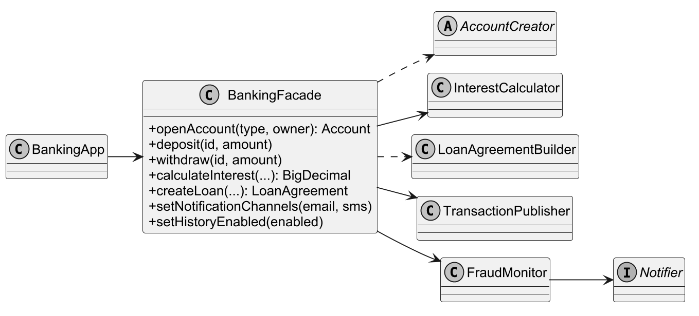

| Category | Patterns in the project |
|---|---|
| Creational | Factory Method and Builder |
| Structural | Decorator and Facade |
| Behavioral | Strategy and Observer |

The patterns cooperate through ordinary method calls and shared abstractions. Account creation uses Factory Method through the facade. Loan construction uses Builder and the loan interest strategy. Transaction processing uses the facade to update an account before Observer publishes the event. FraudMonitor then invokes a notifier that may be wrapped by email and SMS decorators.

This design satisfies the requirement that all six patterns operate inside one framework without forcing every pattern into the same action. The following sections identify the role of each class and show excerpts copied from the reviewed Java source [1]. UML figures show selected members rather than every getter or helper method.

## 3 Factory Method

Responsible student: Moltabayev Ansar. Factory Method is a creational pattern that lets subclasses choose the concrete product created through a common creator API [2]. Here, the product is a bank account, and the variants are SavingsAccount and CurrentAccount.

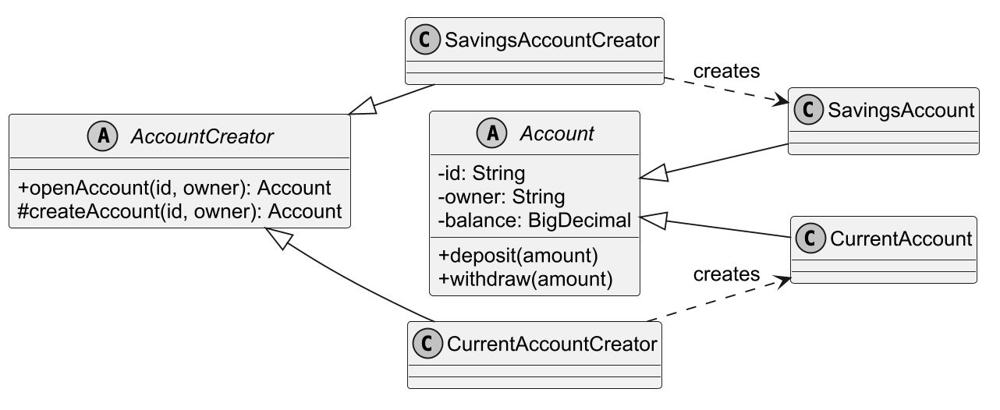

AccountCreator defines openAccount and the abstract factory method createAccount. SavingsAccountCreator and CurrentAccountCreator override the factory method. Both products extend Account, so the rest of the application can use the same deposit, withdraw, and balance operations.

```java
public Account openAccount(String id, String owner) {
    return createAccount(id, owner);
}

protected Account createAccount(String id, String owner) {
    return new SavingsAccount(id, owner);
}
```

Source files: factory/AccountCreator.java, factory/SavingsAccountCreator.java, factory/CurrentAccountCreator.java, and the account classes in model. BankingFacade selects a creator based on the requested type; the concrete creator constructs the product.

### Benefits and tradeoffs

Account construction is separated from the client, and adding an account product does not require changing existing product classes. The cost is an extra creator class for each product. The facade still contains the selection branch, so this implementation does not claim that adding a new type requires no changes anywhere.

Operational evidence: CorePatternsTest checks that the creators return the correct concrete product and reject a blank owner. The Accounts tab exercises the same creation path through the facade.

## 4 Strategy

Responsible student: Moltabayev Ansar. Strategy is a behavioral pattern for interchangeable algorithms [3]. InterestStrategy declares calculate. SavingsInterestStrategy and LoanInterestStrategy provide different formulas, while InterestCalculator holds the selected strategy and delegates the calculation.

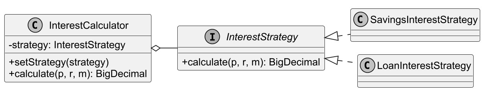

For principal P, annual percentage r, and duration m months, savings interest is P × ((1 + r / 1200)^m − 1). Loan interest is P × r × m / 1200. With P = 10000, r = 12, and m = 12, the results are 1268.25 and 1200.00 respectively.

```java
public void setStrategy(InterestStrategy strategy) {
    this.strategy = Objects.requireNonNull(strategy, "Strategy is required");
}

public BigDecimal calculate(BigDecimal principal, BigDecimal annualRate, int months) {
    MathContext precision = MathContext.DECIMAL128;
    BigDecimal monthlyRate = annualRate.divide(new BigDecimal("1200"), precision);
    BigDecimal multiplier = BigDecimal.ONE.add(monthlyRate).pow(months, precision);
    return principal.multiply(multiplier.subtract(BigDecimal.ONE), precision);
}
```

Source files: strategy/InterestStrategy.java, InterestCalculator.java, SavingsInterestStrategy.java, and LoanInterestStrategy.java. The facade calls setStrategy when the user changes the calculation type. Input validation and final money rounding belong to InterestCalculator rather than to the interface.

### Benefits and tradeoffs

Each formula has its own class, and the context can replace the algorithm at runtime without changing its calculate API. This adds classes for a small number of formulas, but it makes their differences easy to test. The loan estimate uses simple interest and is not an amortized repayment schedule.

Operational evidence: the core test switches strategies on the same calculator, checks both expected values and a zero rate, and rejects invalid amounts, rates, and durations. The UI test checks that selecting Loan displays 1200.00.

## 5 Builder

Responsible student: Moltabayev Ansar. Builder is a creational pattern for assembling a product through explicit steps [4]. LoanAgreementBuilder collects the borrower, amount, annual rate, duration, purpose, and guarantor before creating an immutable LoanAgreement.

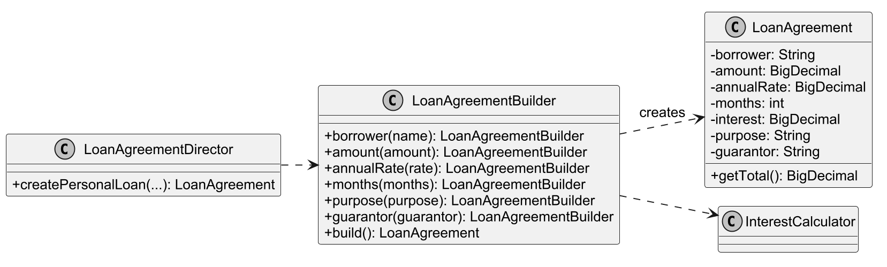

The borrower, amount, annual rate, and duration are required. Purpose defaults to Personal needs, and guarantor defaults to None. The optional LoanAgreementDirector supplies a personal-loan recipe. The interactive interface uses the builder directly for the user-entered terms.

```java
public LoanAgreement build() {
    if (borrower == null || borrower.isBlank()) {
        throw new IllegalArgumentException("Borrower is required");
    }
    if (purpose == null || purpose.isBlank() || guarantor == null || guarantor.isBlank()) {
        throw new IllegalArgumentException("Purpose and guarantor must not be blank");
    }
    InterestCalculator calculator = new InterestCalculator(new LoanInterestStrategy());
    BigDecimal interest = calculator.calculate(amount, annualRate, months);
    return new LoanAgreement(borrower.strip(), Money.positive(amount), annualRate,
            months, interest, purpose.strip(), guarantor.strip());
}
```

Source files: builder/LoanAgreement.java, LoanAgreementBuilder.java, and LoanAgreementDirector.java. The build method validates accumulated data, calls the loan interest calculation, and constructs the final product. Reusing a builder does not change products that were already created.

### Benefits and tradeoffs

Named construction steps avoid a long public constructor and make optional values readable. The tradeoff is mutable intermediate data and additional classes. This is a fluent Builder implementation with one product representation; it does not claim to implement several document formats.

Operational evidence: core checks reject an incomplete agreement, verify the default guarantor, test the director recipe, and check product independence after builder reuse.

## 6 Decorator

Responsible student: Mukashev Arman. Decorator is a structural pattern that adds behavior by wrapping an object with another object implementing the same interface [5]. In this project, every notifier implements send(String message).

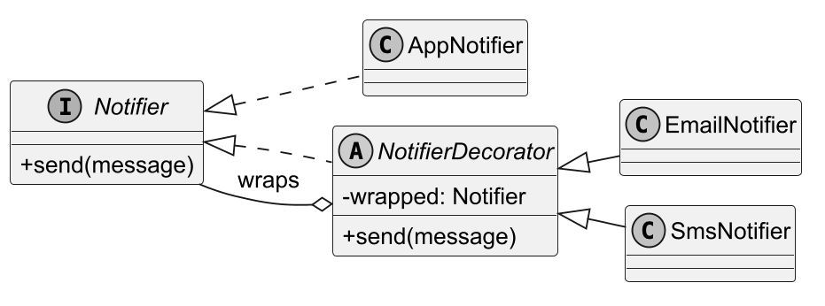

AppNotifier records the base APP delivery. NotifierDecorator stores a wrapped Notifier and delegates to it. EmailNotifier and SmsNotifier call the wrapped notifier before recording their own simulated deliveries. With both options enabled, the chain is SmsNotifier(EmailNotifier(AppNotifier)).

```java
public void send(String message) {
    wrapped.send(message);
}

public void send(String message) {
    super.send(message);
    notifications.add("EMAIL (simulated): " + message);
}
```

Source files: decorator/Notifier.java, AppNotifier.java, NotifierDecorator.java, EmailNotifier.java, and SmsNotifier.java. BankingFacade rebuilds the chain when the user changes the Email or SMS checkbox. Changes apply only to future alerts; existing delivery records remain visible.

### Benefits and tradeoffs

The same base notifier supports APP only, APP with EMAIL, APP with SMS, or all three channels without a subclass for every combination. Wrapping adds indirection, and call order matters. Email and SMS are recorded in a local list rather than transmitted to external services.

Operational evidence: integration checks cover all four combinations and verify APP, EMAIL, SMS delegation order. The Swing test enables Email and verifies its delivery text in the Fraud alerts view.

## 7 Observer

Responsible student: Mukashev Arman. Observer is a behavioral pattern that notifies registered subscribers about events through a shared observer interface [6]. TransactionPublisher is the subject, and TransactionHistory and FraudMonitor implement TransactionObserver.

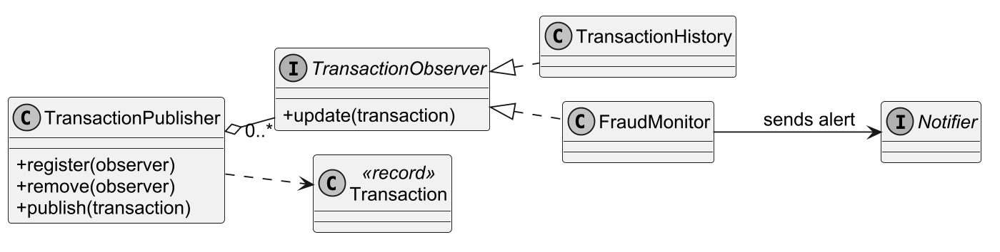

The publisher supports register and remove, prevents duplicate registration, and notifies a copy of its observer list. The facade publishes only after the account operation succeeds. History stores the transaction, while FraudMonitor checks the withdrawal amount independently.

```java
public void publish(Transaction transaction) {
    for (TransactionObserver observer : new ArrayList<>(observers)) {
        observer.update(transaction);
    }
}

public void update(Transaction transaction) {
    if (transaction.type().equals("WITHDRAW") && transaction.amount().compareTo(LIMIT) > 0) {
        String alert = "Suspicious withdrawal: " + transaction.accountId() + " | " + transaction.amount();
        alerts.add(alert);
        notifier.send(alert);
    }
}
```

Source files: observer/Transaction.java, TransactionObserver.java, TransactionPublisher.java, TransactionHistory.java, and FraudMonitor.java. A withdrawal equal to 5000 does not trigger the rule; a withdrawal greater than 5000 does. Removing history does not remove fraud monitoring.

### Benefits and tradeoffs

The publisher depends on the observer interface instead of embedding history and fraud logic. Delivery is synchronous: the built-in observers execute inside the transaction call. Observer-failure isolation, retry handling, and asynchronous queues are outside the current implementation.

Operational evidence: integration checks cover duplicate registration, removal, re-registration, the fraud threshold boundary, and the absence of new records or alerts after a rejected withdrawal.

## 8 Facade

Responsible student: Mukashev Arman. Facade is a structural pattern that offers a simpler entry point to a group of collaborating classes [7]. BankingFacade exposes operations meaningful to the UI, including opening accounts, performing transactions, estimating interest, creating agreements, and choosing notification channels.

Figure 1 shows its dependencies. The following excerpts show the ordering guarantee for a withdrawal and the composition of the notifier chain. The account is updated before an event is published. If withdraw rejects the request, execution never reaches publish.

```java
public void withdraw(String id, BigDecimal amount) {
    Account account = find(id);
    account.withdraw(amount);
    publish(account, "WITHDRAW", amount);
}

public void setNotificationChannels(boolean email, boolean sms) {
    Notifier notifier = new AppNotifier(notifications);
    if (email) {
        notifier = new EmailNotifier(notifier, notifications);
    }
    if (sms) {
        notifier = new SmsNotifier(notifier, notifications);
    }
    fraudMonitor.setNotifier(notifier);
}
```

Source file: facade/BankingFacade.java. The UI calls the facade rather than constructing creators, registering observers, or calculating formulas directly. The constructor registers history and fraud monitoring once. The facade also provides read access to account, history, alert, notification, and agreement collections.

### Benefits and tradeoffs

The interface code has fewer dependencies and does not need to know subsystem ordering. The facade also gives the console demonstration and tests the same business entry point. As features grow, the facade could become too large; separate services would then be appropriate.

List.copyOf protects the returned list structure, but Account objects remain mutable. The facade is therefore a coordination boundary, not a security boundary. The current Swing application invokes business operations on one event-dispatch thread and does not support concurrent account access.

Operational evidence: BankingIntegrationTest exercises the facade across all six patterns, while BankingUiTest activates real Swing component actions and checks their visible text and resulting model values.

## 9 Transaction and notification sequences

A transaction coordinates the facade, account, publisher, and observers. With an initial balance of 12000, withdrawing 6000 produces a balance of 6000, one history entry, and one fraud alert. The alert then enters the configured decorator chain.

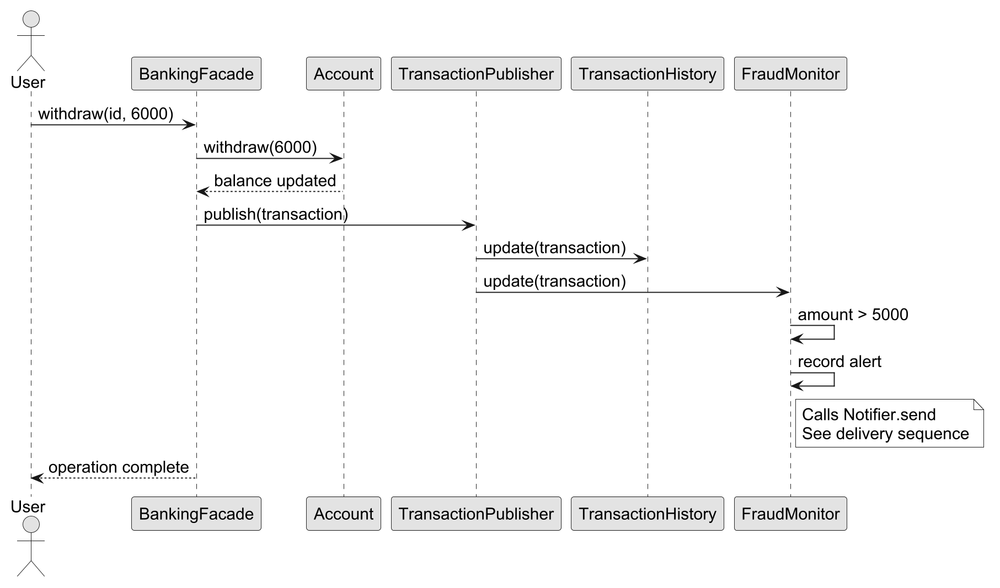

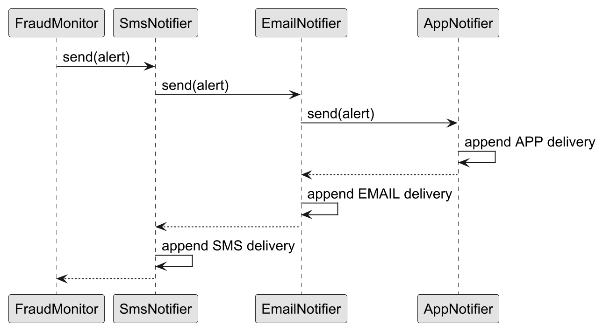

The fraud rule runs after successful balance mutation. It is an educational alert mechanism and does not roll back or block the transaction. The next withdrawal of 100 is accepted and produces a final balance of 5900. A request exceeding the balance throws before publication, leaving history and notifications unchanged.

## 10 Loan agreement sequence

Loan creation uses a separate coordinated workflow. BankingFacade finds the selected account to obtain the borrower, supplies the requested terms to LoanAgreementBuilder, and stores the completed agreement. The builder delegates its interest calculation through InterestCalculator to LoanInterestStrategy.

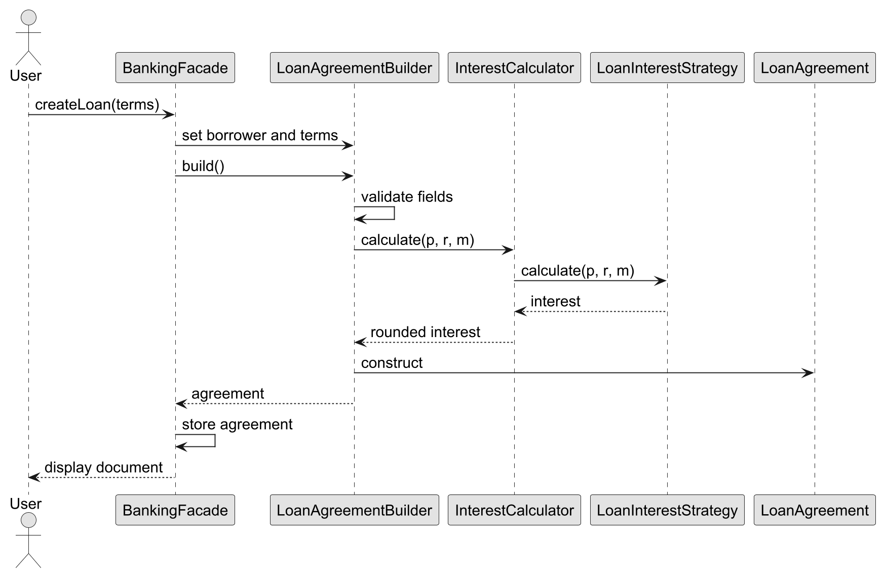

For a 10000 loan at 12% annually for 12 months, the agreement records 1200.00 estimated interest and 11200.00 total repayment. Purpose and guarantor are document fields. No funds are deposited into the account, and no transaction event is published when an agreement is created.

Validation is completed before the agreement is added to the facade list. A missing borrower, invalid amount or rate, or an out-of-range duration prevents construction. A completed agreement contains final fields and does not expose setters.

## 11 Account and interest interface

Figures 10 to 14 use the actual Swing components from revision 39fc5f4. They were rendered offscreen on the event-dispatch thread with the Java cross-platform look and feel, using actions on the real controls. The captures are cropped to remove unused lower space; they are application views rather than operating-system window screenshots.

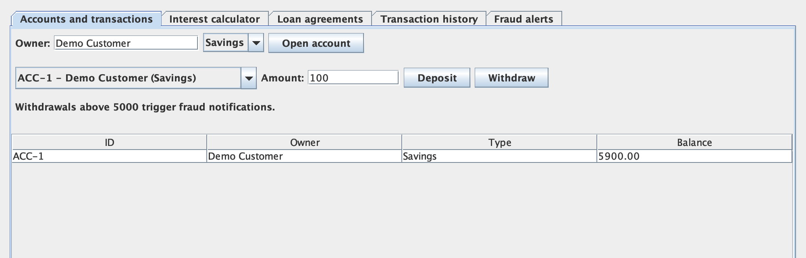

The table shows the generated account ID, owner, type, and final balance of 5900.00. The account selection supplies the target for deposits, withdrawals, and loan agreements.

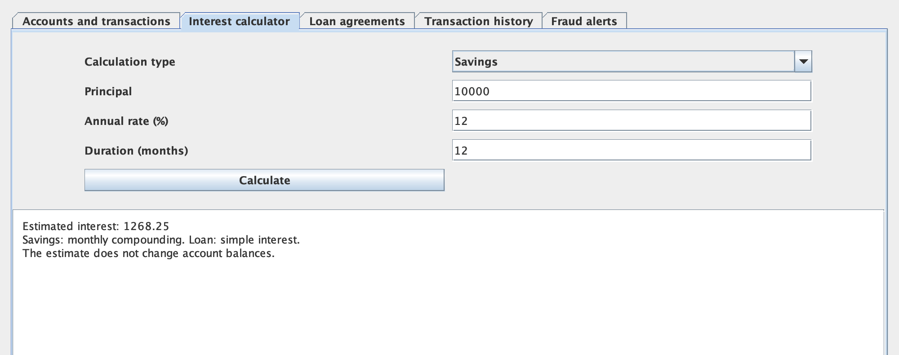

Changing Calculation type to Loan and pressing Calculate replaces the algorithm and returns 1200.00 for the same inputs. Both values are estimates; the calculation does not alter the account balance.

## 12 Loan and fraud interface

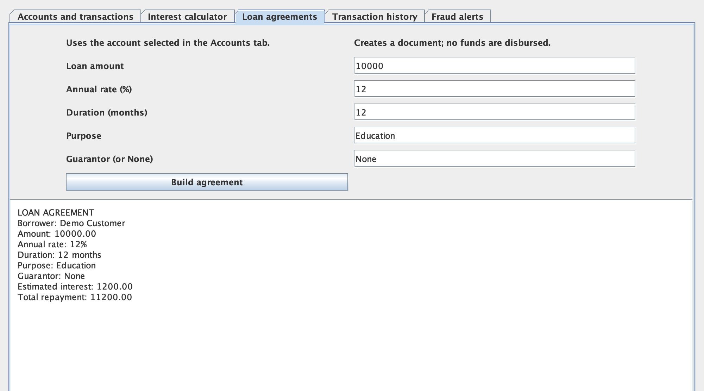

The agreement view combines the selected borrower with the entered loan terms. The builder validates the values and produces the document shown below the form.

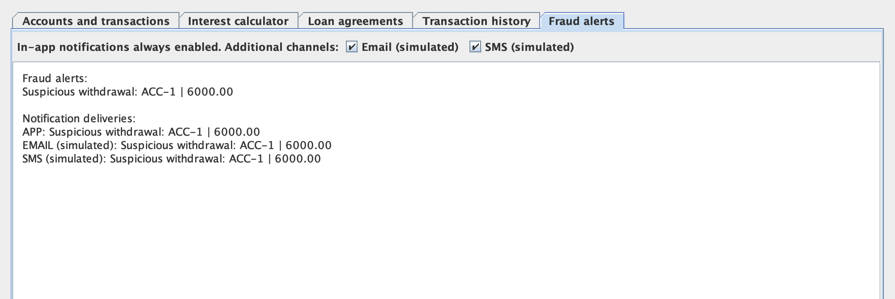

The two checked options demonstrate Decorator composition. The fraud monitor creates one business alert, while the notifier chain adds three channel records. No external message is sent.

## 13 History and demonstration results

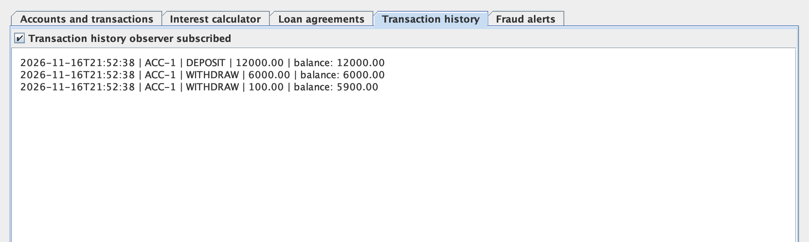

The demonstration uses a single account and the same input values as the interest and loan examples. The history contains a deposit of 12000 followed by withdrawals of 6000 and 100. The resulting balances are 12000.00, 6000.00, and 5900.00.

| Action | Expected and observed result |
|---|---|
| Create Savings account | ACC-1 with an initial balance of 0.00. |
| Deposit 12000 | Balance 12000.00; one history record. |
| Enable Email and SMS | APP notifier wrapped by EmailNotifier and SmsNotifier. |
| Withdraw 6000 | Balance 6000.00; fraud alert and three channel deliveries. |
| Withdraw 100 | Balance 5900.00; no additional fraud alert. |
| Estimate savings interest | 1268.25 for 10000 at 12% over 12 months. |
| Build loan agreement | 1200.00 interest; 11200.00 total; balance unchanged. |

The history subscription checkbox removes only TransactionHistory. When history is disabled, later successful operations still reach FraudMonitor. Re-enabling history affects future transactions; it does not recreate entries for the disabled period. This behavior is covered by integration checks.

## 14 Testing and validation

Verification was run against source revision 39fc5f4 on 16 November 2026. The execution environment used OpenJDK 23.0.2, while javac compiled the project with --release 17. Tests are ordinary Java test harnesses with explicit assertions and require no JUnit dependency.

| Test suite | Observed result | Main coverage |
|---|---|---|
| CorePatternsTest | 19 checks passed | Factory products, owner validation, formula switching, input boundaries, builder validation, immutability, director. |
| BankingIntegrationTest | 51 checks passed | Facade workflows, balance invariants, fraud boundary, observer subscriptions, four channel combinations, delivery order. |
| BankingUiTest | Passed | Account creation, deposit, calculation display, loan creation, decorated notification display, subsequent withdrawal. |

### Important negative cases

| Input or condition | Verified behavior |
|---|---|
| Blank owner | Account creation is rejected. |
| Negative amount or 0.001 | Rejected; the latter rounds to zero at money precision. |
| Withdrawal above balance | Rejected without new history, alert, or delivery. |
| Rate below 0 or above 100 | Interest calculation is rejected. |
| Duration of 0 or 601 months | Interest calculation is rejected. |
| Incomplete agreement | Builder rejects the product. |
| Withdrawal of exactly 5000 | No fraud alert. |
| Withdrawal of 5000.01 | Fraud alert and configured deliveries. |
| Repeated observer registration | No duplicate event delivery. |

### Execution output

```java
Core patterns: 19 checks passed
Banking integration: 51 checks passed
Swing UI: account, deposit, calculation, loan and decorated fraud notifications passed
```

The 70 logic checks and the UI scenario provide behavioral evidence, not a measured code-coverage percentage. The automated UI test runs headlessly and does not validate native window appearance on every operating system.

## 15 Conclusion and further work

### Conclusion

The project implements six design patterns in one working banking simulator. Moltabayev Ansar is responsible for account creation through Factory Method, interchangeable interest calculations through Strategy, and validated agreement construction through Builder. Mukashev Arman is responsible for composable notification delivery through Decorator, transaction subscriptions through Observer, and subsystem coordination through Facade.

The patterns solve distinct problems and participate in coordinated workflows. The strongest example is a withdrawal that updates an account, publishes an event, reaches two observers, and invokes a composed notification chain. A separate loan workflow shows how a builder can use a strategy without requiring the transaction subsystem.

The main benefit is separation of responsibilities. Formulas, product creation, document assembly, listeners, and delivery channels have clear implementation locations. The main cost is a larger number of small classes than a direct procedural solution would require. The scope is intentionally small enough for both team members to explain these relationships during the defense.

### Further work

Persistence is the first practical extension: accounts, history, and agreements could be stored in a database and restored after restart. Authentication and customer authorization would be needed before treating the simulator as a multi-user application. Concurrent balance updates would require transaction-safe storage and explicit synchronization policies.

The loan module could add amortized schedules, repayment tracking, and export to a document file. Fraud monitoring could support configurable rules instead of one fixed threshold. Real email or SMS delivery would require external providers, secure configuration, retries, and delivery status tracking.

The current event publisher could isolate subscriber failures and move notifications to an asynchronous queue. Additional tests could cover those failure paths and native visual behavior across operating systems. These changes extend the simulator while preserving the existing pattern interfaces where practical.

## 16 References and reproduction

[1] Project source
4C0BRA/banking-system. Reviewed revision 39fc5f4c1be11284a1368f8894f05995307aac1d.
https://github.com/4C0BRA/banking-system/tree/39fc5f4c1be11284a1368f8894f05995307aac1d

[2] Factory Method
Refactoring.Guru. Factory Method design pattern.
https://refactoring.guru/design-patterns/factory-method

[3] Strategy
Refactoring.Guru. Strategy design pattern.
https://refactoring.guru/design-patterns/strategy

[4] Builder
Refactoring.Guru. Builder design pattern.
https://refactoring.guru/design-patterns/builder

[5] Decorator
Refactoring.Guru. Decorator design pattern.
https://refactoring.guru/design-patterns/decorator

[6] Observer
Refactoring.Guru. Observer design pattern.
https://refactoring.guru/design-patterns/observer

[7] Facade
Refactoring.Guru. Facade design pattern.
https://refactoring.guru/design-patterns/facade

[8] Java decimal arithmetic
Oracle. Java SE 17 API specification, BigDecimal.
https://docs.oracle.com/en/java/javase/17/docs/api/java.base/java/math/BigDecimal.html

Online references accessed 16 November 2026. The Java excerpts in this report are from the project source; external references provide pattern and API background.

### Reproducing the results

```java
git clone https://github.com/4C0BRA/banking-system.git
cd banking-system
git checkout 39fc5f4c1be11284a1368f8894f05995307aac1d
sh run.sh test
sh run.sh demo
sh run.sh
```

The repository contains the complete Java implementation under src/main/java and test harnesses under src/test/java. UML sources and rendered figures accompany this report. The run script compiles production and test sources using Java 17 compatibility before execution.
